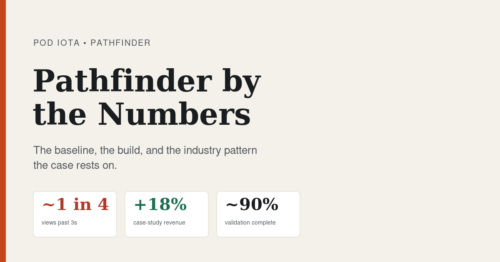

# Pathfinder by the Numbers

A single-page case study for **Pathfinder**, a Core Web Vitals rebuild project: the current performance baseline, what's been built so far, a lab comparison against production, and the industry pattern that makes the investment worth testing.

**Live site:** `https://csmithers-mcc.github.io/pathfinder-numbers/` (enabled once GitHub Pages is turned on for this repo &mdash; see **Publishing**, below)



## What this is

This page is deliberately *not* a victory lap. It lays out, in order:

1. **Same site, same everything?** &mdash; illustrative wireframes (no real content) comparing today's layout to Pathfinder's, to show what structurally changed under a near-identical surface.
2. **The problem** &mdash; why page speed matters for ad revenue, SEO, and Core Web Vitals together, with a real "share of views past 3 seconds" stat.
3. **The baseline** &mdash; current production Core Web Vitals (LCP, INP, FCP, TTFB, CLS), measured against Google's published thresholds.
4. **What we built** &mdash; a plain-language description of the rebuild itself.
5. **The evidence** &mdash; a one-time lab comparison of page weight and load timing between the staging build and production.
6. **How close we are** &mdash; an honest, itemized readiness checklist (by role, not by name).
7. **The case for the payoff** &mdash; publicly documented case studies from other publishers who've made similar investments, used to argue direction, not to promise an exact number for this project.
8. **What we're not claiming** &mdash; a plain statement of the gap between "built" and "proven."

## Repo structure

```
.
├── index.html                   # The page itself (single file, inline CSS/JS reference)
├── style.css                    # All styling, incl. dark mode + animation rules
├── README.md                    # This file
├── SETUP.md                     # How the daily data refresh is wired up
├── assets/
│   ├── compare-before.svg / .png # Wireframe of today's layout (illustrative, no real content)
│   ├── compare-after.svg / .png # Wireframe of the Pathfinder layout (illustrative, no real content)
│   ├── chart1.svg / .png        # Baseline Core Web Vitals (auto-refreshed daily)
│   ├── chart2.svg / .png        # Staging vs. production lab comparison (manual, dated snapshot)
│   ├── chart3.svg / .png        # Industry case studies (fixed external citations)
│   ├── chart4.svg / .png        # Netzwelt case-study callout (fixed external citation)
│   ├── chart5.svg / .png        # "Cost of slow" stat (auto-refreshed daily)
│   └── social-preview.png       # Open Graph / Twitter card image
├── data/
│   ├── baseline.json            # Latest Core Web Vitals averages (machine-written)
│   └── cost_of_slow.json        # Latest "share past 3s" ratio (machine-written)
├── scripts/
│   ├── fetch_baseline.py        # Pulls baseline.json from Amplitude
│   ├── fetch_cost_of_slow.py    # Computes cost_of_slow.json from Amplitude
│   └── render_charts.py         # Regenerates chart1 + chart5 from the JSON above
└── .github/workflows/
    └── refresh-data.yml         # Scheduled Action: runs the three scripts daily, opens a PR
```

## How the data stays current

Two of the five charts (baseline Core Web Vitals and "cost of slow") refresh automatically once a day via a scheduled GitHub Action that queries Amplitude, regenerates the chart images, and opens a pull request with the diff &mdash; nothing auto-merges. The other three (the staging/production lab comparison and the two industry-citation charts) are fixed or manually dated, for reasons explained inline on the page itself and in detail in **[SETUP.md](SETUP.md)**.

If you're setting this repo up fresh, SETUP.md has the full walkthrough: required secrets, optional variables, and a list of assumptions in the fetch scripts that should be verified against a live run before the schedule is trusted.

## Privacy approach

This repo and site are public, so the content here has been deliberately written to exclude anything that shouldn't leave the building:

- No raw traffic or pageview counts &mdash; only rounded ratios and percentages.
- No internal vendor, tool, or platform names &mdash; described generically (e.g., "our ad decisioning platform").
- No internal URLs &mdash; no staging domain, no live internal analytics dashboard links, no Confluence/Docs links. Citations to genuinely public sources (web.dev, Think with Google, other publishers' public case studies) are kept and linked.
- No individual names &mdash; readiness items are attributed to roles, not people.

If you're extending this page, keep that bar: round the number, name the role, cite the public source, and skip the rest.

## Previewing locally

No build step &mdash; it's a static page. Either open `index.html` directly in a browser, or serve it so relative paths behave exactly like they will on GitHub Pages:

```
python3 -m http.server 8000
# then visit http://localhost:8000/
```

## Publishing

Settings &rarr; Pages &rarr; Source: deploy from a branch &rarr; `main` / `/ (root)`. Once enabled, GitHub will serve this `index.html` at the Pages URL for this repo.

## Credit

Built by Pod Iota for Pathfinder.
